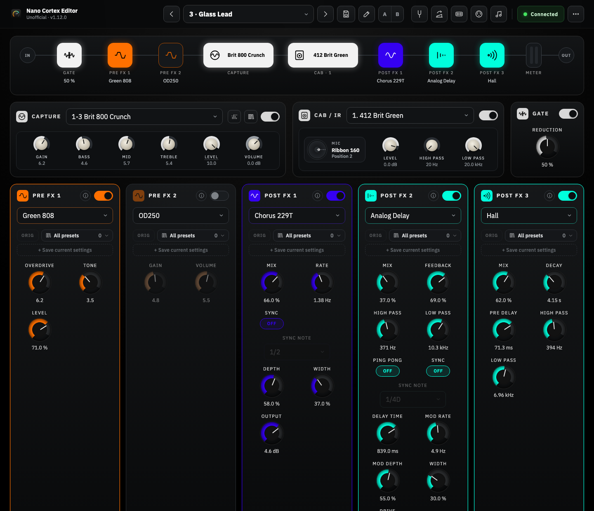
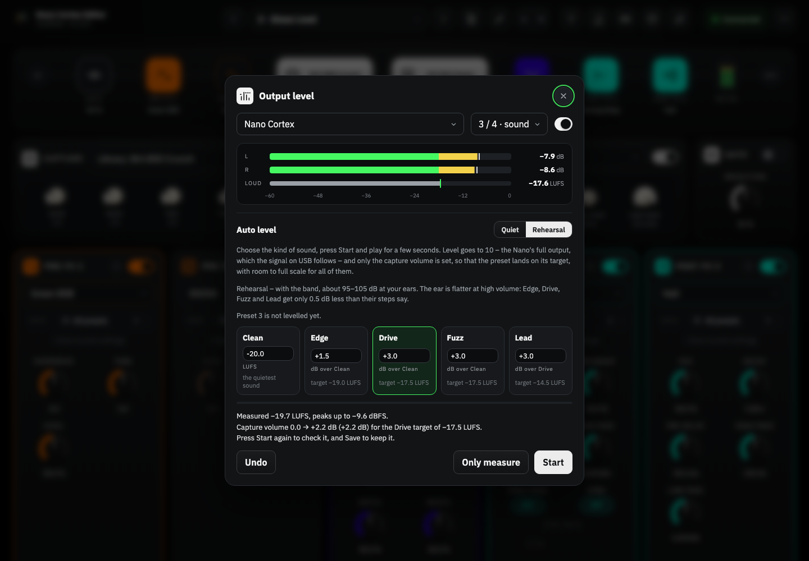
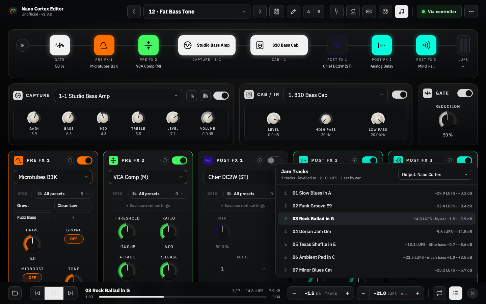
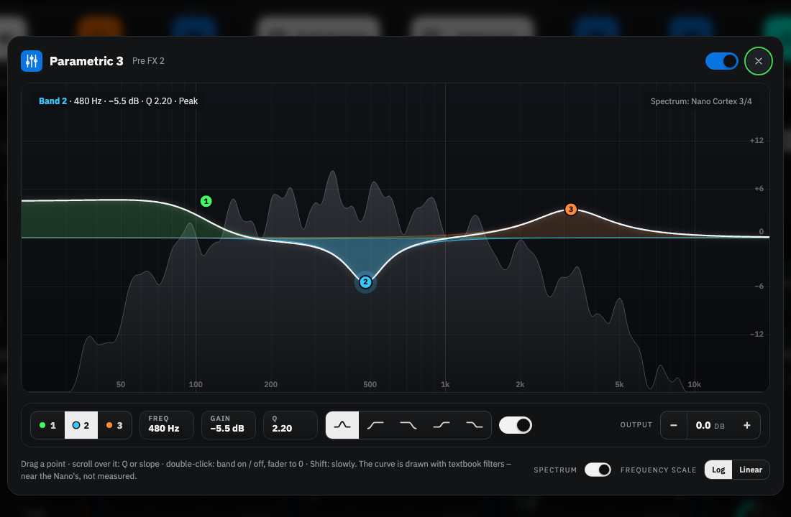
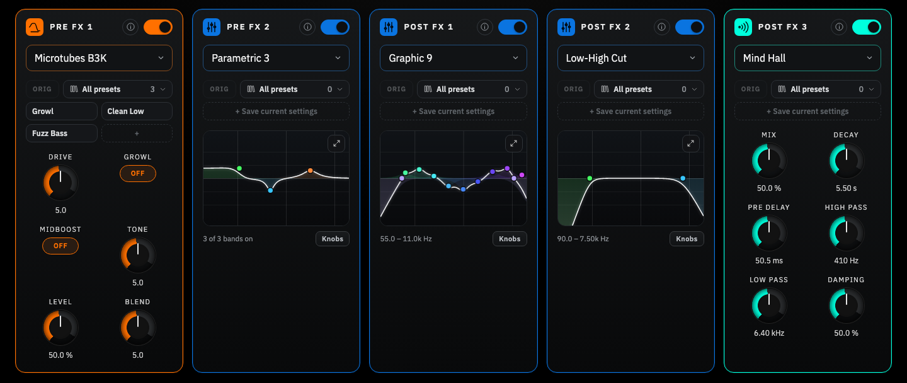
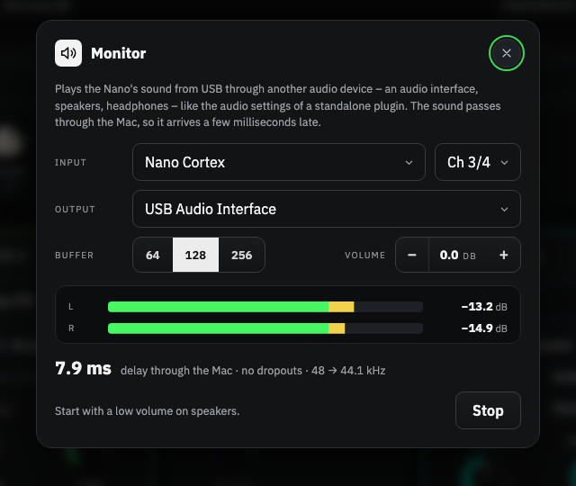

# Nano Cortex Editor (unofficial)

A desktop editor for the **Neural DSP Nano Cortex** that talks to the pedal over Bluetooth.
It runs in the browser (Chrome, Edge – online at **https://drd85.github.io/nano-cortex-editor/**, using Web Bluetooth) or as a Mac app. Make sure the Nano Cortex name includes "Nano Cortex" to avoid connection issues!

> **Unofficial community project.** Not affiliated with, endorsed by or supported by Neural DSP.
> "Nano Cortex", "Quad Cortex" and "Neural DSP" are trademarks of Neural DSP Technologies.
> The editor writes to your device. Use it at your own risk and keep backups of your presets
> (for example with the official Cortex Cloud app).
>
> The whole Project is done with the help of Claude Code. 



## Features

- **Signal chain** at the top, as on the Quad Cortex: Gate → Pre FX 1–2 → Capture → Cab → Post FX 1–3, each block in its
  colour – filled when on, outlined when off, dashed when empty. Click a block to make it light up below,
  **double-click** to switch it on or off
- **Mute guitar input / output** – the round **IN** and **OUT** at the two ends of the signal chain are switches
  for the Nano's settings *Mute Guitar Input* and *Mute Guitar Output*: one click and the end turns into a red sign
  with **Muted** below, one more and it is back. Both are under **…** as well. With the output muted the guitar is
  silent at the output jacks, while the sound from USB stays. The Nano keeps both settings, also after the editor
  is closed
- **Compact top bar**: preset arrows, preset list (a dot marks unsaved changes, and **Save** turns green), save,
  rename and **A/B** in the middle, then icons for tuner, expression, footswitches, MIDI and the jam tracks – hover an
  icon for its name. The **Connect** button shows the connection. **…** (or a click on the connection) holds the rest:
  preset files (export, import), the MC6 Pro export, the two mutes, refresh, keyboard shortcuts, copy log and disconnect.
  Until the Nano is connected, the editor shows a short connect screen instead of placeholder values
- **Presets**: switch presets over Bluetooth (no USB cable needed), rename, save (the Save button only shows "Saved" after reading the preset back); follows preset changes made on the pedal.
  Unsaved changes show as a dot and a green Save – also for the cab's mic, position, level and filters, which the
  Nano itself does not report as changes
- **Copy a preset to another slot**: the last entry of the preset list, **Copy to another slot …**, shows the 64
  presets – choose the one to replace, give the copy a name (the Nano wants every name once) and it is stored there
  as it sounds now, unsaved changes and expression pedal assignments included. The editor reads the Nano's list
  again and only then says "Copied"
- **Footswitches of the Nano**: the footswitch icon opens the four slots **1A, 1B, 2A, 2B** – choose the preset each
  one calls up, or put the loaded preset on a slot with one click. The change is stored on the Nano at once and read
  back as a check; the preset list shows the slot next to the name (B slots need the Nano's 4-Preset Mode)
- **Amp, gate and FX blocks**: all knobs with live, lag-free updates, model selection for Pre FX 1–2 and Post FX 1–3, block colours per effect category (Quad Cortex style).
  Capture, cab and gate are three slim strips above the effects: symbol, choice and switch on one line, the knobs
  below – for the capture Gain, Bass, Mid, Treble and Level (0–10) plus the capture **Volume**. **Level** is the
  Nano's master output volume (its LEVEL knob): it belongs to the device, not to the preset, so Save does not store
  it – the loudness of a preset is the capture Volume
- **EQ view**: the Nano's EQ models (Parametric 3, Graphic 9, Low-High Cut) show a response curve with points to
  drag in place of rows of knobs – small in the block, large in a dialog; in the Mac app with the spectrum of the
  Nano's sound behind it
- **FX presets**: any number of named settings per effect model. Up to four favourites sit as buttons above the knobs
  (as many as the Nano Cortex Controller has places) – click to load, right-click or hold to save over them, rename or
  delete. **All presets** lists every preset of the model: load, star as favourite, rename, overwrite, delete, or save
  the current settings as a new one. **ORIG** returns to the settings read from the Nano
- **A/B compare**: click **A | B** (or press **A**) and the settings as they are now are remembered as A. Change what
  you like, then switch between A and your changes to hear the difference – only what differs is sent, so the switch
  is quick. It covers amp, capture and its volume, cab, gate and all five effects with their models and values.
  **Save** keeps the side you hear; **×** ends the compare
- **Output level** (Mac app, Nano connected with a USB-C cable as well): a small stereo meter before the **OUT** of the
  signal chain shows the Nano's sound from its USB audio (channels 3/4) – peaks left and right, below them the loudness in
  LUFS. Click it for the large meter. macOS asks once for the audio input ("microphone"); nothing is recorded
- **Auto level**: choose **Clean**, **Drive**, **Solo** or **Fuzz**, press **Start** and play for four seconds – with
  Level at 10 (full output), the capture volume is set so that the preset lands on the loudness of its kind (clean
  lowest, solo about 3 dB above drive) and its peaks stay below full scale. The four targets can be changed;
  **Only measure** reads a preset you like and can take it as the target
- **Jam tracks**: a player along the bottom of the window (the note symbol). Choose the folder with your backing
  tracks once: every track is measured and played at one loudness just below your presets, so you can play along
  without touching a volume – the files stay as they are. A track that still sits differently against the guitar
  gets its own correction by ear, which is remembered. Previous, play / pause and next can be assigned with MIDI
  Learn, and the footswitches of the Nano Cortex Controller work them in its looper mode
- **Preset files** (under **…**, or ⌘E / ⌘I): **Export** saves the current preset as a file (to keep or to share), **Import** – or dropping the
  file on the window – loads one into the current preset; **Save** keeps it. Captures and IRs travel by name: the
  import finds them in your slots or loads them from the Nano's library (factory and Cortex Cloud ones). The captures
  themselves cannot be transferred over Bluetooth.
- **Captures**: the symbol shows the capture's type (amp head, combo, amp + cab, cab, pedal …); 25 capture slots plus the capture library on the device, with a browser for categories, instruments, tags and search; load library captures into a slot of your choice – the editor can show which presets use each slot and suggest a free one
- **Cab/IR**: slots, level and high / low pass as knobs; for factory cabs a small tile shows the mic and its place –
  a click opens the speaker with the five mic types and the positions 1–6; load factory or user IRs from the device library into a slot
- **Monitor** (Mac app, under **…**): plays the Nano's USB sound through another audio device – an audio interface,
  speakers, headphones –, like the audio settings of a standalone plugin
- **Keyboard shortcuts**: ⌘S save, ← → previous / next preset, ⌘E export, ⌘I import, T tuner, A for A/B, Space for the jam tracks, ? for the overview
  (Ctrl instead of ⌘ on Windows)
- **Tuner**: note and cents display, reference pitch (400–480 Hz), mute
- **Expression pedal**: per-preset assignments for Gain, Bass, Mid, Treble, Level, Gate and FX amounts (min/max, invert) and bypass switching (Heel-Toe, Switch, Stop)
- **MIDI controller with MIDI Learn**: map knobs and buttons of any USB/Bluetooth MIDI controller to amp, FX, gate, capture and cab controls, block on/off, tuner and preset up/down; optional pickup mode (no value jumps) and Program Change → preset
- **Morningstar MC6 Pro export**: pick up to five presets and create a bank file: page 1 A–E recall the presets, F opens an FX page where A–E switch the five FX slots on/off. The switches are named after the effect type, use the category colours and MC6 Pro icons, and show which effects each preset uses
- **Effect info**: the **i** in each effect block shows what the model does, a few
  tips for its controls and – where Neural DSP names it – the original it is based on (e.g. Green 808 → Ibanez TS808).
  The "based on" names follow Neural DSP's device list; they are trademarks of their owners and only identify the
  originals
- Optional: your own pedal pictures next to each effect's model choice (see *Pedal pictures* below)
- Log export for troubleshooting

## Use it

### In the browser

Open **https://drd85.github.io/nano-cortex-editor/** (or `index.html` from this repository) in **Chrome** or **Edge**
on macOS, Windows, ChromeOS or Android, click **Connect** and choose your Nano Cortex.

| Browser | |
|---|---|
| Chrome, Edge | works |
| Brave | works after enabling Web Bluetooth: `brave://flags` → **Web Bluetooth API** → *Enabled*, relaunch; if Connect still does nothing, turn the Shields off for the editor page |
| iPhone / iPad | the **Bluefy** browser (Safari has no Web Bluetooth) |
| Safari, Firefox | no Web Bluetooth – not possible |

The Nano takes one Bluetooth connection at a time: close the Cortex Cloud app (also on your phone) and switch off a
Nano Cortex Controller board before connecting directly.

### Mac app

Download the zip from [Releases](../../releases), unzip it and move **Nano Cortex Editor.app** to *Applications*.
The app is not signed with an Apple Developer ID. On the first start, right-click it and choose **Open**.
If macOS says the app is damaged, run `xattr -cr "/Applications/Nano Cortex Editor.app"` once in Terminal.
macOS asks for Bluetooth access when you connect for the first time.
Zoom with **⌘ +**, **⌘ −** and **⌘ 0** (or *View* in the menu bar), as in the browser; the app keeps the zoom.
The window has no title bar: its buttons sit in the editor's top bar, which also moves the window.

### With the Nano Cortex Controller

The [Nano Cortex Controller](https://github.com/DrD85/nano-cortex-controller) (an ESP32 touch screen with
footswitches, firmware 1.2.0 or newer) can pass the editor through to the Nano: switch the controller on, wait until
it has loaded the presets, then click **Connect** and choose **Nano Cortex Controller** (the Mac app picks it by
itself). The status shows *Connected via controller*, and editor and controller work at the same time. Without the
controller, connect to the Nano directly as before.

No board? The controller also runs in the browser:
[Nano Cortex Controller Web](https://github.com/DrD85/nano-cortex-controller-web).

## Build the Mac app

Requires [Node.js](https://nodejs.org) on an Apple Silicon Mac.

```bash
cd mac-app
./build.sh            # app for yourself, includes your pedal pictures from ../img if present
./build.sh --public   # release build without pedal pictures, plus a zip in ../release
```

The app is a small [Electron](https://www.electronjs.org) shell around `index.html`
(Safari/WKWebView has no Web Bluetooth), plus three small helpers written in Swift that `build.sh` compiles – the
level meter, the monitor and the spectrum, for what a page cannot do with the Nano's USB audio. So the
build also needs the Swift compiler of Xcode or its command line tools (`xcode-select --install`). It connects to the first Bluetooth device whose name contains
"Nano" or "Cortex" – the Nano itself or the Nano Cortex Controller. The version in `mac-app/package.json` must match
`EDITOR_VERSION` in `index.html` (shown next to the title); `build.sh` checks it.

## Output level and Auto level

The Nano Cortex is also an audio interface over USB-C with eight channels: **1/2 carry the dry guitar signal (DI),
3/4 the sound with capture and effects**. With the cable plugged in (Bluetooth stays the connection for editing),
click the meter symbol in the Capture card or the meter tile before **OUT** in the signal chain. The first time macOS asks whether
the app may use the "microphone" – that is the Nano's USB audio. The editor only measures the samples: nothing is
recorded or sent anywhere.



- **Meter**: peaks of the left and right channel in dBFS with peak hold, and the loudness of the last three seconds in
  LUFS (K-weighted as in ITU-R BS.1770). The small meter in the signal chain keeps running after the dialog is closed.
- **Input and channels**: the Nano is found by its name and measured on channels **3 / 4**; the two lists at the top
  choose another input or another pair.
- **Auto level**: pick the kind of sound, press **Start** and play the way you would in the song. After four seconds
  of playing (pauses do not count) the capture volume moves by the distance to the target, at most so far that the
  peaks stay 1 dB below full scale. **Undo** takes it back, **Save** keeps it. If the capture volume reaches the end of
  its range (−24 to +12 dB), the note says how much is missing.
- **Level at 10**: the signal on USB follows the preset's Level (the LEVEL knob on the Nano). So Auto level first reads
  the preset from the Nano and measures with Level at 10, the full output, and leaves it there – the capture volume
  alone sets how loud a preset is, and all presets compare. If Level is lower, the first press says so and the second
  sets it: that gets louder, so turn your monitors down first. Auto level changes nothing else.
- **Levelled presets**: the editor remembers for each preset what it was levelled as and how loud it measured. The
  preset list shows it behind the name – `✓ Drive −19.0` on target, `Drive −21.3 (−2.3)` beside it – once the preset
  is saved. The note goes when the saved preset no longer fits it (another capture volume, Level off 10) or with
  **Forget** in the dialog. It is kept in this browser or app, not on the Nano.
- **Targets**: Clean −20, Drive −19, Solo −16 and Fuzz −19 LUFS are a starting point. They can be typed in; with
  **Only measure** on a preset you like and *Take … as the target* all four move by the same amount.

**Mac app or browser?** Channels 3/4 need the Mac app: it reads the input with a small helper
(`mac-app/native/nano-meter.swift`). A browser on the Mac opens every input with more than two channels as stereo, so
the page only gets channels 1/2 – on the Nano the dry signal, which the capture volume does not change. The editor
says so and Auto level stays off there. Measuring another interface that records the Nano's outputs works in the
browser as well.

## Jam tracks



Click the note symbol in the top bar: a player appears along the bottom of the window and stays there while you
edit. The folder symbol chooses the folder with your backing tracks – once per start of the editor. It plays mp3,
m4a (AAC), wav, flac and ogg; the Mac app also plays **Apple Lossless** (m4a), AIFF and CAF, which it has macOS read
(a browser cannot, and says so in the track list). Protected files from a music subscription cannot be played.

- **One level for all tracks:** each track is measured once (integrated loudness, ITU-R BS.1770, the same scale as
  the output meter) and then played with the gain that brings it to the level shown in the player. That level is
  counted from the **Drive** target of Auto level, 2 LU below it to begin with (−21 LUFS); **−** and **+** of
  *LUFS · all* move all tracks together. The files are not changed, and the measurements are remembered.
- **The bass counts less:** of two tracks at the same LUFS, the one with less bass has more of its sound where the
  guitar plays, and seems louder against it. The tracks are therefore matched on their loudness without the bass
  (below about 200 Hz: −3 dB at 200 Hz, −12 dB at 100 Hz). A usual full mix keeps its level; a track with little
  bass plays up to 1.4 dB quieter, one with much bass up to 3 dB louder, and the track list says so from half a dB
  on (*little bass −0.8*).
- **One track by ear:** what is left – a quiet verse and a loud chorus, a dense arrangement – is yours to set.
  **−** and **+** of *dB · track* correct the track that is loaded, in steps of 0.5 dB; the editor remembers it for
  that file (by folder and file name, also after a new bounce), and the track list shows it as *by ear*. A click on
  the number clears it.
- **Through the Nano:** set the track list's *Output* to the Nano (or the Mac's sound output), so the tracks come out
  of the Nano together with your guitar. With the Nano connected, its *USB playback volume* is read and made up for,
  so that setting does not move the balance. A track whose peaks would clip is played as loud as they allow.
- **Controls:** previous, play / pause (also the space bar), next, a click into the progress bar, repeat one track,
  and the track list. The player keeps playing when it is hidden.
- **With your feet:** connect the editor through the [Nano Cortex Controller](https://github.com/DrD85/nano-cortex-controller)
  (from 1.9.0) and switch the controller to its looper mode (hold footswitch 1): footswitch **2** plays and pauses,
  **7** goes to the previous and **8** to the next track. *MIDI → Start MIDI Learn* assigns other footswitches – or
  any MIDI controller – to the three buttons.

How loud a track sits against the guitar in the Nano's output depends on the Nano's own mixing, which the editor
cannot measure: if all tracks are too loud or too quiet, set the level once with **−** / **+** of *LUFS · all*.

## EQ view



The Nano's three EQ models – **Parametric 3**, **Graphic 9** and **Low-High Cut** – show what they do as a curve:



- **In the block:** a small curve. Its points can be dragged right there; a click beside them, or on the arrows in
  the corner, opens the large view. **Knobs** below the curve brings the knobs back (they are what MIDI Learn
  assigns), **Curve** returns.
- **In the large view:** one point per band, each in its colour with its own soft shape; the bright line is all of
  them together.
  - **Drag** a point: frequency and gain. **Scroll** over it: Q (Parametric 3) or the slope (Low-High Cut).
    **Shift** while dragging: slowly.
  - **Double-click:** a band on / off (Parametric 3), a fader back to 0 dB (Graphic 9).
  - Below the graph: choose a band, click **Freq**, **Gain** or **Q** to type a value, pick the band's shape (peak,
    high pass, low pass, high shelf, low shelf), switch it on or off, and set the **Output** level.
- **Spectrum** (Mac app): with the Nano on a USB-C cable, the large view shows the spectrum of its sound behind the
  curve – what comes out of the Nano (USB channels 3/4), after all its effects. It runs while the view is open; the
  switch *Spectrum* hides it. Its height has a scale of its own (−96 to −12 dBFS), not the curve's dB.
- Every change goes to the Nano at once, as with the knobs; FX presets, A/B and preset files work as before.

Two things are assumptions. The **curve** is drawn with textbook filters – near what the Nano does, not measured from
it. And the **frequency scale**: the Nano takes a frequency as the travel of a control (0–1), and how that becomes Hz
is not documented. A logarithmic control is assumed; *Frequency scale: Log / Linear* at the bottom right switches it
(what the Nano gets stays the same, only the Hz shown change). To check it, set a steep low pass in *Low-High Cut* and
play: with the right scale the drop in the spectrum sits at the point.

## Monitor



Mac app only. The Nano sends its sound to the Mac over USB; the Monitor plays it through **another audio device** – an
audio interface, the Mac's speakers, headphones –, like the audio settings of a standalone plugin. A USB-C cable from
the Nano to the Mac is all it needs; no Bluetooth.

1. Connect the Nano with a USB-C cable and open **…** → **Monitor**.
2. **Input**: *Nano Cortex* and *Ch 3/4* are chosen for you – 3/4 is the Nano's sound, 1/2 the dry guitar signal.
3. **Output**: the device you want to hear it on. The Nano itself is not offered: it would get its own sound back.
4. **Start** – with a low volume on speakers.

- **Volume**: 0 dB = as the sound comes from the Nano; the Mac's own volume for that output comes on top.
  **Buffer** 64 / 128 / 256: smaller is a shorter delay, larger is safer against dropouts.
- The dialog shows the **delay** through the Mac and counts **dropouts**. Closed, the monitor keeps playing and the
  **…** button shows a green dot; **Stop** ends it, and so does quitting the app.
- The sound passes through the Mac, so it arrives late: with the built-in speakers about 8 ms at buffer 64, 11 ms at
  128 and 18 ms at 256. A display's speakers or Bluetooth headphones add far more. The Nano's own outputs have no such
  delay – if you hear both ways at once, you hear it as an echo.
- With the jam tracks: choose the same output in the track list, and guitar and tracks mix on the Mac.
- Another input than the Nano can be chosen; the editor asks first, because a microphone played through speakers howls.

## MIDI controller

Click the **MIDI** icon → **Start MIDI Learn**, click a knob, slider or switch in the editor and move a control on your
MIDI controller. Assigned controls show their CC number; right-click a control to remove its assignment.
Assignments are stored in the browser/app. MIDI needs Chrome, Edge or the Mac app.

## Morningstar MC6 Pro

Open **…** → **Morningstar MC6 Pro export**, tick up to five presets, check the Nano's MIDI channel (read from the Nano automatically)
and press **Create bank file**. To read which FX are on in each preset, the editor loads each selected preset on the
Nano for a moment and then returns to the current one (save unsaved changes first). Load the file in the Morningstar editor (open a bank → *Load from File*) and save it
to the controller. Connect the MC6 Pro's USB Host port to the Nano's USB port: the Nano only accepts MIDI via USB.

**Expression switch (optional):** choose one FX switch (for example E for a reverb in Post FX 3) under *Expression switch*.
Instead of on/off it sends the expression pedal position (CC#1): dim = heel = *Min*, lit = toe = *Max* of that slot's
Amount under **Expression** in each preset. Every preset switch starts at heel. Once an expression switch is chosen, its
FX block in the editor shows two sliders, **Pos 1** and **Pos 2**: they set this range for the loaded preset, and dragging
one also sets the effect's Mix so you hear the result. The export preview warns about presets without that assignment
and lists other parameters that the expression pedal moves too.

The long name of each preset switch lists the effect types in Pre FX 1, Pre FX 2 and Post FX 1, for example
`Pit-Com-Cho` for pitch, compressor and chorus.

## Pedal pictures

The editor comes without pedal pictures: each effect shows its symbol and category colour. If you would like a
picture next to the model choice, put your own PNG files into an `img/` folder next to `index.html`, using the file
names listed in `MODEL_IMAGES` inside `index.html`. The `img/` folder is not part of this repository.

## How it works

The Nano Cortex exposes a Bluetooth LE service with a write characteristic (`c304`) and a notify
characteristic (`c305`). Messages are protobuf payloads framed as
`[length] C0 [payload] [32-bit little-endian message type]`; larger replies are split into several packets.
The message layouts used here are documented in comments in `index.html`.

## Credits

- [IBM Plex Sans](https://github.com/IBM/plex) by IBM (SIL Open Font License 1.1, `fonts/OFL-IBM-Plex-Sans.txt`) –
  the typeface of the editor (Latin subset, embedded unchanged in `index.html`)
- [rixrix/deskop-nano-cortex](https://github.com/rixrix/deskop-nano-cortex) (Apache-2.0): its protocol
  notes helped with the state dump layout and the preset-change acknowledgement.

## License

[MIT](LICENSE)

---

## Deutsch (Kurzfassung)

Inoffizieller Editor für den Neural DSP Nano Cortex per Bluetooth. Er läuft in Chrome/Edge oder als Mac-App.
Du kannst Presets wechseln, umbenennen und speichern und Amp, Gate und Effekte live bearbeiten.
Oben zeigt eine Signal Chain alle Blöcke: Ein Klick lässt den Block unten aufleuchten, ein Doppelklick schaltet ihn an oder aus.
Captures und Cabs lädst du aus der Library des Geräts. Dazu gibt es einen Tuner, die Zuweisungen
für das Expression-Pedal und die Steuerung per MIDI-Controller mit MIDI Learn.
Mit **A | B** vergleichst du den gemerkten Stand mit deinen Änderungen. Ist der Nano zusätzlich per USB-C verbunden,
zeigt die Mac-App seinen Ausgangspegel (USB-Kanäle 3/4) und stellt mit **Auto level** die Capture-Lautstärke nach ein
paar Sekunden Spielen passend für Clean, Drive, Solo oder Fuzz ein. Im Browser kommen am Mac nur die Kanäle 1/2 (DI) an.
Unten im Fenster lässt sich ein **Jamtrack-Player** einblenden: Ordner wählen, und alle Tracks laufen gleich laut,
knapp unter deinen Presets; der Nano Cortex Controller schaltet sie im Looper-Modus mit den Fußschaltern.
Die EQ-Modelle zeigen eine **Kurve mit Punkten zum Ziehen** statt Knopfreihen, in der Mac-App mit dem Spektrum des
Nano-Tons dahinter. Der **Monitor** (Mac-App, unter **…**) spielt den USB-Ton des Nano über ein anderes Audiogerät ab.
Der letzte Eintrag der Preset-Liste **kopiert das geladene Preset auf einen anderen Platz**, und ein Klick auf das
die runden **IN** und **OUT** an den Enden der Signal Chain schalten den Gitarren-Eingang und -Ausgang des Nano stumm
(die Geräte-Einstellungen „Mute Guitar Input" und „Mute Guitar Output"); der Pegelmesser sitzt als Kachel vor OUT.
Die Mac-App gibt es unter *Releases*. Sie ist nicht signiert: Starte sie beim ersten Mal per Rechtsklick → **Öffnen**.
Der Editor schreibt auf dein Gerät, die Nutzung erfolgt auf eigene Gefahr.
