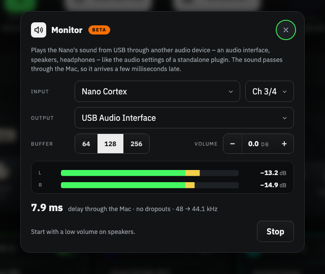

# Nano Cortex Editor Beta – Monitor

> **Beta 1.8.0-beta.1.** A separate app, *Nano Cortex Editor Beta*, next to the normal editor. It is the normal
> editor (1.7.0) plus one thing to try out: the **Monitor**. So far it is tested with a test tone on the Mac –
> **not yet with a Nano Cortex**. If you try it, please tell me how it goes (see *What I would like to know*).

## What it does

The Nano Cortex sends its sound to the Mac over USB. The Monitor plays that sound through **another audio device** –
an audio interface, the Mac's speakers, headphones – like the audio settings of a standalone plugin: choose an
input, choose an output, start. One USB-C cable from the Nano to the Mac is all it needs; no Bluetooth.

## Install

1. Download `Nano-Cortex-Editor-Beta-1.8.0-beta.1-mac-arm64.zip` (Apple Silicon), unzip it and move
   **Nano Cortex Editor Beta.app** to *Applications*. The normal app stays where it is.
2. First start: right-click → **Open**. If macOS says it is damaged:
   `xattr -cr "/Applications/Nano Cortex Editor Beta.app"`.
3. macOS asks the beta for **Bluetooth** and the **microphone** again – for macOS it is a new app. The microphone
   permission is what lets it listen to the Nano's USB audio; nothing is recorded.

Good to know: the beta keeps **its own settings** (MIDI assignments, Auto level targets, jam track corrections start
empty), so nothing of the normal app is touched. The Nano takes one Bluetooth connection at a time: quit the normal
editor before you connect the beta. The Monitor itself works without connecting.

## Use

1. Connect the Nano to the Mac with a USB-C cable.
2. Click the **speaker symbol** in the top bar.
3. **Input**: *Nano Cortex* and *Ch 3/4* are chosen for you – 3/4 is the Nano's sound, 1/2 the dry guitar signal.
4. **Output**: the device you want to hear it on. The Nano itself is not offered: it would get its own sound back.
5. **Start**. Start with a low volume on speakers.

- **Volume** is the level of the monitor, 0 dB = as the sound comes from the Nano. The Mac's own volume for that
  output comes on top.
- **Buffer** 64 / 128 / 256: smaller is a shorter delay, larger is safer against dropouts.
- The dialog shows the **delay** through the Mac in milliseconds and counts **dropouts**. You can close it: the
  monitor keeps playing, and the speaker symbol shows a green dot. **Stop** ends it; so does quitting the app.
- Another input than the Nano can be chosen, too. The beta asks first: a microphone played through speakers howls.

## What to expect

- **Delay.** The sound goes Nano → USB → Mac → output device, and every step adds a little. On my Mac, with a test
  tone in place of the Nano and the built-in speakers, the dialog showed about 8 ms at buffer 64, 11 ms at 128 and
  18 ms at 256. Outputs differ: a display's speakers or **Bluetooth headphones add much more** (Bluetooth easily
  150 ms) – not for playing. The Nano's own outputs have no such delay.
- **The number in the dialog** is what the Mac knows: both devices' buffers and their reported latencies, what
  waits between them and the converter. What a device does not report is not in it.
- **Two clocks.** Input and output are two devices with two clocks. The monitor plays a few millionths faster or
  slower so that nothing piles up or runs dry; it also converts the sample rate if the output runs at another one.
  After a dropout it keeps a little more in reserve, so the delay can grow slightly while it runs.
- **With the jam tracks.** Choose the same output in the track list of the jam player: guitar and tracks then mix
  on the Mac, both on the level the editor sets them to.
- The Nano's own outputs keep playing as always. If you hear both ways at once, you hear the delay as an echo:
  turn one of them down.
- Only in the Mac app – a browser gets just the first two channels of the Nano (the dry signal).

## What I would like to know

- Which output device, which buffer, and the delay the dialog shows.
- Does it feel playable? Any dropouts, clicks, or a sound that drifts off after a while?
- Would you use it – and what is missing (a mute, more channels, the dry signal for re-amping …)?

Please open an [issue](https://github.com/DrD85/nano-cortex-editor/issues) and name the build (it is in the top
left corner: *v1.8.0-beta.1*).

## How it is built

The beta is the normal app with three additions: a small helper next to the app (`nano-monitor`, Swift, Core
Audio) that reads the chosen channel pair, keeps it in a short buffer and plays it through the output with a
varispeed unit; the bridge to the page (`mac-app/monitor.js`); and the dialog (`mac-app/beta/monitor-page.js`),
which the build puts into the app's page. `mac-app/build.sh --beta` builds it. The normal app and the web editor
do not contain any of it.

Unofficial community project – not affiliated with Neural DSP.

---

**Deutsch:** Die Beta ist eine eigene App neben dem normalen Editor und probiert eine Sache aus: den **Monitor**.
Er spielt den Ton, den der Nano per USB an den Mac schickt (Kanäle 3/4), über ein **anderes Audiogerät** ab –
Interface, Lautsprecher, Kopfhörer –, wie die Audio-Einstellungen eines Standalone-Plugins. Nano per USB-C
anschließen, Lautsprecher-Symbol oben anklicken, Ausgang wählen, **Start**; auf Lautsprechern leise beginnen.
*Volume* regelt den Pegel (0 dB = wie vom Nano), *Buffer* die Verzögerung gegen Aussetzer. Der Dialog zeigt die
Verzögerung durch den Mac und zählt Aussetzer; er kann geschlossen werden, der Monitor läuft weiter (grüner Punkt).
Der Ton läuft durch den Mac und kommt deshalb einige Millisekunden später an (bei mir mit Testton rund 8 ms bei
Puffer 64, 11 ms bei 128, 18 ms bei 256; Bluetooth-Kopfhörer deutlich mehr). Die Beta hat eigene Einstellungen und fragt macOS
erneut nach Bluetooth und Mikrofon. **Bisher nur mit Testton geprüft, noch nicht mit einem Nano** – Rückmeldungen
bitte als Issue.
